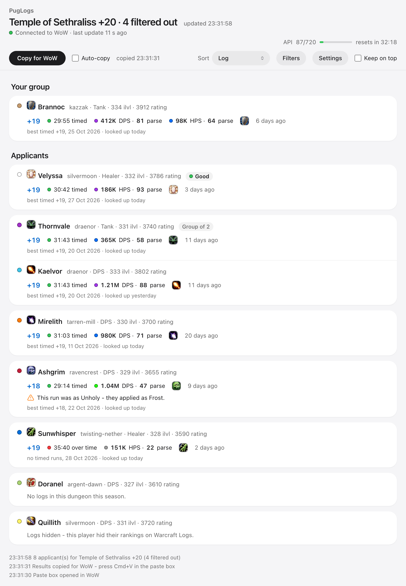
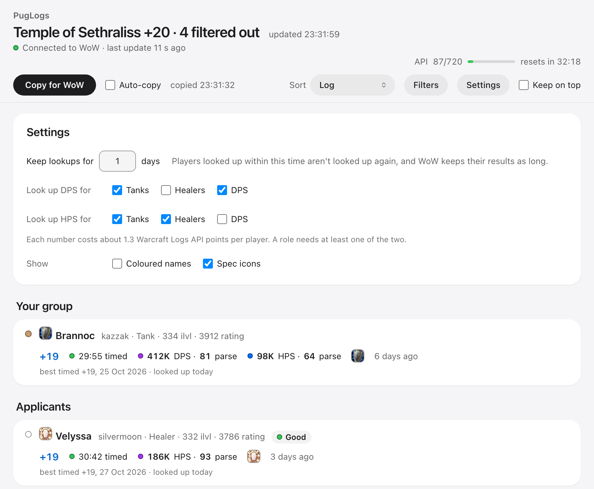
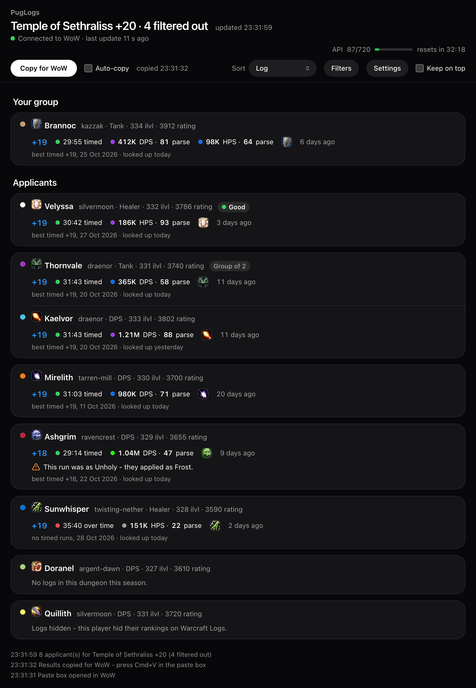

# PugLogs

**See your Mythic+ applicants' Warcraft Logs runs right in the Group Finder, and filter out the
ones you'd never invite.**

When you list a key, dozens of players apply. Checking them on Warcraft Logs means finding each
character page, picking your dungeon and digging for a run at your key level. PugLogs does that for
every applicant: hover them and you see their run, or read the whole list in a panel next to the
Group Finder.

PugLogs has two parts: the **WoW addon**, and the free **PugLogs app** for Windows and macOS. WoW
addons can't go online, so the app looks your applicants up on Warcraft Logs. Its window updates by
itself; to get the results into WoW's tooltips and panel, click **Paste logs** and press
Cmd+V / Ctrl+V (addons can only take in pasted text). Filters, the applicant panel, My players and
Check logs work without the app.



## What it does

**Warcraft Logs runs** (with the app)
- **Their best timed run in the dungeon you listed, at or below your key level**: you list a +20
  Murder Row, you see their best timed +20 Murder Row (or +19 if they haven't timed a +20) - in the applicant tooltip, the PugLogs panel and the app
  window. Runs in the role they applied as come first; if they have none, another role's run is
  shown with a warning ([which run is shown](#which-run-is-shown)).
- **DPS, or HPS for healers**, with the percentile Warcraft Logs shows on the log. Per role you
  choose DPS, HPS or both (e.g. a tank's DPS and HPS).
- **Warnings** when the run was played in another role (red) or another spec (orange), and
  "No logs" / "Logs hidden" shown as such.
- **Saved lookups:** someone who applies again shows their run right away, with no new paste and no
  API points (kept 1 day by default, up to 365). **Look up logs again** fetches one player fresh.
- **Your group:** the players in your party are looked up too, for your group's dungeon.
- **Raids** (off by default): bosses killed at your difficulty and their average parse.

**In WoW** (no app needed unless noted)
- **Applicant panel** next to the Group Finder: your applicants without the filtered ones, grouped
  by role, sorted by Log, DPS, Rating, iLvl, Role or Applied order, with **Invite** and **Decline**
  buttons.
- **Filters:** minimum item level, minimum M+ rating, roles, classes and specs, specs (or classes)
  already in your group, and minimum DPS (needs the app). Filtered applicants are never looked up.
- **My players:** mark anyone **Good**, **Okay** or **Avoid** with a note; it shows in their
  tooltip, and chat tells you when they apply or join your group.
- **Check logs** in the right-click menu: a link to their Warcraft Logs page for your dungeon.

**The app**
- A **live window** next to the game: applicants and your group with their runs, updating within
  seconds. Click a key level to open that exact log. Its own sort and filters, Settings, and a meter
  of your Warcraft Logs API use.
- **Copy for WoW** puts the results on the clipboard by hand; with **Auto-copy** it updates the
  clipboard whenever results change.
- **Installs and updates the addon**, and updates itself.

> Status: personal project, tested on macOS with WoW Retail (Midnight Season 2), EU realms only.
> The Windows app is built and checked on every release, but has seen less play than the Mac one.

---

## What you see

**In the PugLogs window** (an app window next to WoW; tick "Keep on top" to float it over the game).
Click a key level to open that log, click a name for their Warcraft Logs page. **Look Up Again**
appears when you point at a player. The window follows your system's light or dark mode.

| | |
|---|---|
|  |  |

(The players in these pictures are made up.)

**In the Group Finder tooltip**, under Raider.IO's lines:

```
PugLogs - Murder Row
+19  31:03 timed        364K DPS (57)
as Balance
best timed +19 - 3 Oct 2026
Looked up today
```

Filtered players say why (hover the panel's footer, or the player when hiding is off), e.g.
`PugLogs: filtered out (item level 325 < 330)` or `a Frost Mage is already in your group (Anna)`.
Players you saved in My players show your mark and note.

---

## How it works

World of Warcraft addons can't access the internet or talk to other programs. So PugLogs has
two parts that pass data through the only channels the game allows:

```
 ┌──────────── WoW ────────────┐        ┌──────── Your computer ────────┐        ┌─ Warcraft Logs ─┐
 │ PugLogs addon               │        │ PugLogs companion (Python)     │        │                 │
 │ - reads your applicants     │ QR in  │ - reads the QR, deletes it     │  API   │ run history     │
 │ - applies your filters      │ ─────► │ - looks players up             │ ─────► │ per player and  │
 │ - draws a tiny QR code and  │ screen │ - shows the live window        │ ◄───── │ dungeon         │
 │   takes a screenshot        │ shot   │ - copies results on request    │        │                 │
 │ - shows results in tooltips │ ◄───── │                                │        └─────────────────┘
 └─────────────────────────────┘ paste  └────────────────────────────────┘
```

1. **Game → companion:** when your applicants or your group change, the addon waits 1.5 seconds
   for more changes, shows a small, faint QR code (dark grey on black) in the top-left corner for a
   couple of frames and takes a WoW screenshot (at most one per second; your screenshot quality
   setting is restored right after). Never in combat or during a key. The companion watches the
   Screenshots folder, decodes the code and deletes the screenshot. Your own screenshots are never
   touched.
2. **Companion → Warcraft Logs:** it asks the Warcraft Logs API for each new applicant's runs in
   that dungeon and picks the run to show.
3. **Companion → game:** addons can't receive data while the game runs, but they can accept text
   you paste. Click **Paste logs** in the Group Finder; the companion puts the results on your
   clipboard, you press Cmd+V / Ctrl+V, and the tooltips fill in. Your previous clipboard text is
   put back a minute later.

The addon never automates gameplay, never sends chat messages and never reads game memory.

---

## Why you need a Warcraft Logs API key

The run data comes from the **Warcraft Logs API**, and Warcraft Logs requires every program that
uses it to identify itself with an API client (a "key"). It is **free** and takes a minute to make.

- **Each person needs their own key.** Every key has an hourly budget (720 points per hour on a
  free key). Sharing one key means sharing one budget, and Warcraft Logs' terms don't allow it.
- **How far it goes:** a dungeon lookup costs about **1.3 points** per player and number (DPS or
  HPS), so a free key covers roughly **500 new applicants per hour** with one number. Lookups are
  kept for **Keep lookups for** in the app's Settings (1 day by default), so players who apply
  again cost nothing, and filtered-out applicants are never looked up. If the hour runs out,
  lookups pause and continue automatically when it resets.
- **Your key stays on your computer**, in a settings file outside this project. Never commit it
  or send it to anyone.

### Creating the key

1. Log in at [warcraftlogs.com](https://www.warcraftlogs.com) and open
   [API Clients](https://www.warcraftlogs.com/api/clients/) → **Create Client**.
2. Name: anything (e.g. `PugLogs`). Redirect URL: type `http://localhost` (the form requires
   one; PugLogs doesn't use it). Leave "Public Client" unchecked.
3. Paste the **Client ID** and **Client Secret** into the PugLogs setup page.

---

## Requirements

| | |
|---|---|
| Game | World of Warcraft Retail 12.x (Midnight), current Mythic+ season |
| Region | **EU** realms (other regions need a realm table - see Limitations) |
| Computer | macOS or Windows |
| Warcraft Logs | A free account and API client (see above) |
| Display | WoW in **windowed** mode if you want the live window next to the game (macOS can't place windows over fullscreen games) |

Nothing else to install: the download includes everything it needs (only running from source needs Python).

---

## Install

1. **The PugLogs app** - from [Releases](https://github.com/roeescharf-sys/PugLogs/releases/latest):
   - **Windows:** run **PugLogs-Setup.exe** (Next → Install; no administrator rights needed).
     If Windows says "Windows protected your PC", click **More info → Run anyway**.
   - **macOS:** open **PugLogs-macOS.dmg** and drag PugLogs into Applications. If macOS says it
     can't be opened: **System Settings → Privacy & Security → Open Anyway**. The first start
     can take up to half a minute.

   These warnings appear because PugLogs isn't signed with a paid developer certificate.
2. **Start PugLogs.** It **installs the WoW addon for you** (or keeps the one you have from
   CurseForge/Wago if it's up to date) and opens its window, which walks you through creating
   your free Warcraft Logs API client and pasting it in.
3. In WoW, type `/reload` - or restart the game if this is the first install (WoW only sees new
   addon files after a restart). If you had the addon before the app, turn on live lookups in
   `/pl opt` (or tick the PugLogs box next to Paste logs).

Next time, just start PugLogs before you list a key. It tells you in its window when a new
version is out; **Update Now** downloads it, installs it and restarts PugLogs (the Windows
installer version, or the Mac app in Applications). PugLogs finds WoW by itself (including custom install folders known to
Battle.net); if it can't, its window asks you to choose the World of Warcraft folder. To change your API key later, use **Change API Key** at the bottom of
its window; the download link is also in `/pl opt` in game.

### Running from source (developers)
Requires Python 3.12+. Clone the repository, then start `companion/run.sh` (macOS) or
`companion\run.bat` (Windows); the first run creates a private Python environment. Build the
downloads with `python companion/build.py`, or push a `v*` tag to have GitHub build both.
On macOS you can symlink the addon into WoW to edit it in place
(`ln -s "$PWD/PugLogs" "/Applications/World of Warcraft/_retail_/Interface/AddOns/PugLogs"`).

---

## Using it

1. **List a Mythic+ key** in the Group Finder. Applicants appear in the PugLogs window within a few
   seconds of applying.
2. **Hover** over an applicant to see their run in the tooltip: click **Paste logs** (above your
   group's role icons), wait for "Ready", press **Cmd+V / Ctrl+V**.
3. **Click a key level** in the window to open that exact log on Warcraft Logs (Damage Done tab,
   or Healing for HPS). Click a name for their Warcraft Logs page for your dungeon.
4. **Right-click** any applicant or player → **Check logs** for their Warcraft Logs page.

### Which run is shown
For a +20 listing: their best timed **+20** (highest percentile among their +20s - DPS, or HPS for
healers). If they have no timed +20, the closest lower key; if all their timed runs are higher, the
closest higher one; if nothing is timed, their highest run, marked "over".

The key level comes from the keystone in your bags, if it's for the listed dungeon. If PugLogs can't
tell the level (e.g. you listed someone else's key), it shows their highest timed run.

Only runs in the **role they applied as** are considered (a healing run says little about how
someone plays DPS). If they have no logs in that role, their run in another role is shown with a
red warning; a run in another spec of the same role gets an orange note.

Players who hid their rankings on Warcraft Logs are shown as **"Logs hidden"** (not "no logs") and
always listed at the bottom of the window, whatever the sort.

The percentile is the one Warcraft Logs shows on the log: DPS (or HPS) compared with the same spec
at the same key level, in Warcraft Logs' colours. The date of the run is shown too.

### DPS and HPS
By default healers are looked up by **healing (HPS)** and everyone else by **damage (DPS)**. In the
app's **Settings** you choose per role (tanks, healers, DPS) whether to see DPS, HPS or both - a
tank's HPS, for example. Each number costs about 1.3 Warcraft Logs API points per player; with
both, the second number comes from the same run when that run has it, otherwise from their best
run for that number.

### Saved lookups
Every lookup is saved, in the app and in WoW, for as long as **Keep lookups for** in the app's
Settings says (1 day by default). Someone who applies again shows their run right away, without a
new paste and without spending API points. Tooltips and the window say when a player was looked
up. To ask Warcraft Logs again anyway: **Look Up Again** next to the player in the app window, or
**Look up logs again** in their right-click menu in WoW (then Paste logs). Saved runs are per
dungeon: if you list the same dungeon at another key level, Paste logs to get the run for your new
key.

### Players in your group
With **Look up the players in my group** (in `/pl opt`, on by default) PugLogs also looks up the
players in your party - whether or not you're the leader - for your group's dungeon (its listing,
the last one it had, or your own key). After **Paste logs** (or `/pl paste` when the group isn't
listed), hover a player in your group to see their run. The app window lists them under
"Your group".

### My players
Right-click any player (an applicant, someone in your group, a name in chat) → **Add to my
players...** to save them as **Good**, **Okay** or **Avoid**, with a note ("great tank, logs undersell
him"). The list is saved for your whole account. The panel's **My players** tab shows it - filter
by role and mark, click a player to edit or remove them; `/pl players` (or `/pl opt` → **Open my
players**) opens it without the Group Finder. Your mark and note show in their tooltip (as an
applicant, in the world or in your party frames), PugLogs tells you in chat when a saved player
applies or joins your group (you can turn that off in `/pl opt`), and the app window shows your
marks. With **Hide players
I marked Avoid** (in `/pl opt`, off by default) they're left out of the panel and the app and never
looked up; Blizzard's own list isn't changed.

### Raids
With **Look up raid applicants** (in `/pl opt`, off by default), listing the current raid shows
each applicant's **bosses killed** at your listing's difficulty and their **average parse** (best
and median) - DPS, HPS or both like for dungeons. A raid lookup costs about **5 API points** per
player and number (a dungeon lookup about 1.3). The raids are in `PugLogs/Data/Season.lua`.

### Applicant panel
Next to the Group Finder, while you look at your applicants, PugLogs shows its own list: your
applicants **without the filtered ones, grouped by role** (tanks, healers, DPS) and **sorted inside
each group by Log, DPS, Rating, iLvl, Role or applied order**. A group that applied together stays
together, placed by its best member. Each row shows the player's run from your last paste (key,
timed or over, percentile, DPS or HPS; `!` = run in another role, `*` = another spec). Hover a row
for the full tooltip. **Invite (+)** and **Decline (x)** sit on each application.

The footer counts the filtered applicants (and Avoid players); hover it to see who and why. The
panel itself never changes Blizzard's own list. It sits beside Raider.IO's profile window when
that's shown; drag it anywhere. Its X hides it (`/pl panel` brings it back). In `/pl opt` you can
hide it, put it back in its automatic spot after dragging, and turn off Invite and Decline.

### Settings (`/pl opt`, or Options → AddOns → PugLogs)
- **Live Warcraft Logs lookups with the PugLogs app** - turn off if you only want "Check logs"
  and the filters; then no screenshots are taken. On by default if the PugLogs app was installed
  the first time you logged in with PugLogs (the app adds a tiny "PugLogs (app)" addon so the
  addon can tell). If you had the addon before the app, tick it yourself. The same switch is
  next to the **Paste logs** button in the Group Finder ("PugLogs" checkbox).
- **Only while I can invite** (on by default) - as a group member who isn't leader or assistant,
  PugLogs doesn't send applicants on its own (Paste logs still looks them up).
- **Look up the players in my group** (on by default) and **Look up raid applicants** (off by
  default) - see above.

### Filters
- **Minimum item level** and **minimum M+ rating**
- **Minimum DPS** (in thousands, e.g. 300 = 300K) - for applicants who applied as DPS, using the
  DPS of the run PugLogs shows for them, so it applies after **Paste logs**. Players without a
  pasted run (or with hidden/no logs) aren't filtered by it.
- **Roles** they applied as, **classes** and **specs** (ticking a class ticks all its specs;
  Select all / Clear all)
- **Hide filtered applicants** from the Group Finder list (on by default). A group that applied
  together is hidden if any member doesn't match.
- **Hide specs already in your group** (on by default), or whole classes (off by default) - you
  included. Updates as players join or leave, and chat says so; someone who declines your invite
  never counts. Other players' specs come from what they applied with, or from a quick background
  inspect.
- **Sort the applicant list by** Blizzard's order (default), role, M+ rating or log (after Paste
  logs). A group counts as its best member.

Hiding and sorting change Blizzard's own list. Since Midnight this can make the Group Finder show a
Lua error ("attempt to compare a secret number value"). If you see it, untick **Hide filtered
applicants** and use Blizzard's order - the PugLogs panel shows the same filtered, sorted list and
never touches Blizzard's.

"Spec" is the spec a player is in when they apply, which can differ from the one they'd play.
Filters are for Mythic+ listings, not raids. Filtered applicants are never sent to the app, so
they're never looked up.

### Commands
| Command | |
|---|---|
| `/pl opt` | Open the settings (live lookups, group and raid lookups, applicant panel, filters, My players, app download link) |
| `/pl panel` | Open the PugLogs panel (applicants and My players), also after closing it with its X |
| `/pl players` | Open your saved players (Good / Okay / Avoid, with notes) |
| `/pl Name-Realm [dungeon]` | Link to a player's logs, e.g. `/pl Anna-Kazzak voidscar` |
| `/pl paste` | Open the paste box when your group isn't listed (no Paste logs button then) |

Everything else is a button: **Paste logs** next to the Group Finder (or a key binding in
Options → Keybindings → AddOns), and **Check logs**, **Look up logs again** and **Add to my
players...** in the right-click menu. `/puglogs` works the same as `/pl`.

For troubleshooting (not listed in game):

| Command | |
|---|---|
| `/pl test` | Take one test screenshot and report each step in chat |
| `/pl send` | Send your current applicants to the companion again |
| `/pl debug` | Show which dungeon PugLogs detects |
| `/pl debug on\|off` | Show each step of a paste request in chat |
| `/pl qr subtle\|classic` | Faint dark code (default) or the black-and-white one if the faint one isn't read |

---

## Troubleshooting

- **The window says "Waiting for the addon..."**: make sure the companion is running, then
  `/pl test` in game. The line under the listing says whether codes arrive and which folder it
  watches. If it says screenshots arrived without a PugLogs code, try `/pl qr classic`.
- **"Hourly API limit reached"**: lookups resume automatically when the hour resets.
- **"PugLogs is already running"**: it's already open - look for its window (or quit it first).
- **Something else went wrong**: use **Send to Developer…**, **Report on GitHub** or **Copy Error
  Report** at the bottom of the window. The log is in `~/.config/puglogs/puglogs.log`
  (Windows: `C:\Users\<you>\.config\puglogs\puglogs.log`).
- **The paste box says "No answer from the PugLogs app - is it running?"**: the PugLogs app isn't
  running (e.g. it was stopped with Ctrl+C in its Terminal window). Start it, then click **Copy for
  WoW** in its window and press Cmd+V / Ctrl+V, or open the paste box again.
- **"That wasn't PugLogs results" / "Those were older results"**: the clipboard didn't hold the
  answer yet, or you copied something after "Ready". Press Cmd+V / Ctrl+V once more. If you paste
  again more than about 8 seconds after "Ready", the box asks the app again - press it again when it
  says "Ready".

---

## Privacy

- Your API key and the lookup cache live only in `~/.config/puglogs/` on your computer.
- The companion talks to Warcraft Logs (the names and realms it looks up) and checks GitHub for
  new PugLogs versions. With **Spec icons** on (the default) its window loads the icons from
  Warcraft Logs' image server. The window talks to the companion over a connection that only
  works on your own computer.
- **Error reports** are sent only when you choose to: with **Send Report** (in the error bar) or
  **Send to Developer…**, or automatically if you ticked **Send errors automatically from now on**
  (off until you do). They go to the developer's private Discord channel and contain the PugLogs
  version, your system, the error and what PugLogs was doing (which may include an applicant's
  character name). Only **Send to Developer…** also includes all of this session's errors, the
  window's recent messages, the end of this and the previous session's log, and the note and
  contact you type (both optional). Your computer's username and your API key are removed first. Nothing else is sent anywhere.
- PugLogs screenshots are deleted as soon as they are read. Old ones left from times the companion
  wasn't running are deleted (not used) on the next start.

---

## Limitations

- **EU only for now.** WoW gives realm names without spaces ("TwistingNether"); Warcraft Logs
  needs "twisting-nether". The EU table is in `PugLogs/Data/RealmsEU.lua`
  (regenerate with `tools/gen_realms.py`); other regions need their own table and `ns.REGION`.
- **Each season** the dungeon list changes: update `PugLogs/Data/Season.lua` and
  `SEASON_ZONE_ID` in `companion/app.py`.
- Only damage and healing are shown. Interrupts, dispels and other stats were tried but cost
  several API points per run, so they were removed.
- Raid listings are recognised by the raid's English name, so raid lookups need an English
  game client for now.
- Tooltips update when you paste (one keystroke); the live window updates by itself.
- The Windows app has seen less play than the Mac one.

---

## Project layout

```
PugLogs/              the WoW addon
  Core.lua            links, realm names, /pl command
  Menu.lua            right-click menu: Check logs, Look up logs again, Add to my players
  CopyPopup.lua       copyable link pop-up
  Filters.lua         filters, hiding applicants, options panel
  Panel.lua           applicant panel and My players tab
  Players.lua         My players (Good / Okay / Avoid)
  Transport.lua       QR screenshots to the companion
  Live.lua            paste box, saved lookups and tooltips
  Bindings.xml        paste box key binding
  Data/               season dungeons and raids, EU realm names
  Libs/qrencode.lua   QR code library
companion/            the program (Python)
  app.py              main program and live window server
  window.py           the app window
  web/index.html      the window's page
  lookup.py           Warcraft Logs lookups and run choice
  wcl.py              Warcraft Logs API client
  inbox.py            reads QR screenshots
  payload.py          the QR code format
  export.py           the text pasted into WoW
  clipboard.py        clipboard on macOS and Windows
  wowdir.py           finds World of Warcraft
  installer.py        installs/updates the addon in WoW
  updates.py          update check and Update Now
  report.py           error log and error reports
  build.py            builds the downloads (PyInstaller)
  packaging/          Windows installer script
  run.sh / run.bat    start scripts (running from source)
relay/                error-report relay (Cloudflare Worker -> private Discord channel)
docs/api-costs.md     measured API costs
tools/gen_realms.py   regenerates the EU realm table
```

## License

MIT - see [LICENSE](LICENSE). The bundled QR library keeps its BSD 3-clause license.

## Credits

- QR codes: [luaqrcode](https://github.com/speedata/luaqrcode) by Patrick Gundlach, BSD 3-clause
  (license in `PugLogs/Libs/qrencode.lua`).
- EU realm list generated from [LibRealmInfo](https://github.com/phanx-wow/LibRealmInfo) by Phanx (zlib).
- The QR-screenshot idea was inspired by [ApplicantScout](https://github.com/Antrakt92/ApplicantScout-Addon);
  PugLogs is an independent implementation.
- Run data from the [Warcraft Logs API](https://www.warcraftlogs.com/v2-api-docs/warcraft/).
