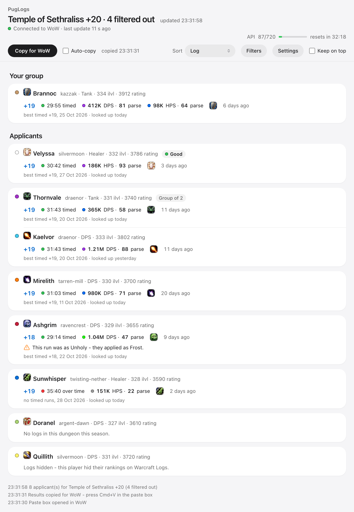
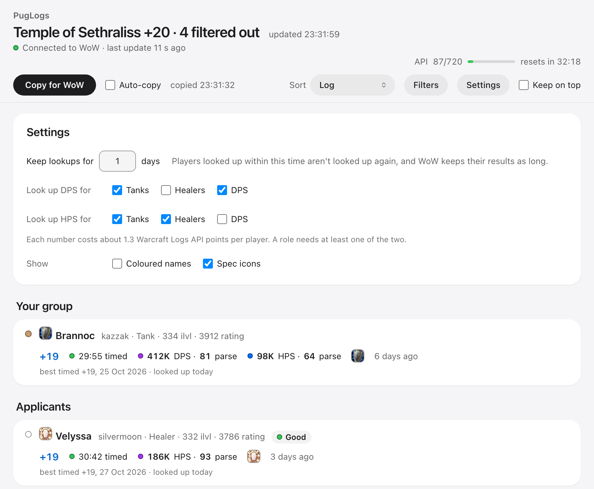
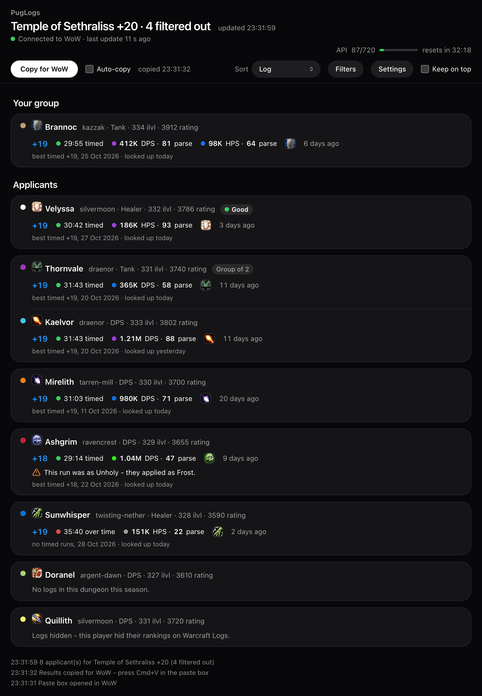

# PugLogs

**See your Mythic+ applicants' Warcraft Logs runs right in the Group Finder, and filter out the
ones you'd never invite.**

When you list a key, dozens of players apply. Checking them on Warcraft Logs means finding each
character page, picking your dungeon and digging for their best run. PugLogs does that for
every applicant: hover them and you see their run, or read the whole list in a panel next to the
Group Finder.

PugLogs comes in two parts:

- **The addon** (this download): filters, the applicant panel, My players and Check logs links.
  These work on their own.
- **The free PugLogs app** for Windows and macOS: looks your applicants up on Warcraft Logs and
  hands the results to the addon. WoW addons can't go online, so the runs need the app.
  Download: https://github.com/roeescharf-sys/PugLogs/releases/latest



---

## Warcraft Logs runs for your applicants (with the app)

Hover an applicant and you see **their highest timed run in the dungeon you listed**. You list a
Temple of Sethraliss, you see their highest timed Temple of Sethraliss:

```
PugLogs - Temple of Sethraliss
+19  31:03 timed        364K DPS (57)
as Balance
highest timed - 12 Oct 2026
Looked up today
```

- **DPS, or HPS for healers**, with the **percentile** Warcraft Logs shows on the log (same spec,
  same key level), in Warcraft Logs' colours. In the app you choose per role whether to see DPS,
  HPS or both - a tank's DPS and HPS, for example.
- **The right run:** runs in the role they applied as come first. You get their highest timed run (the
  best percentile if they timed that level more than once); if nothing is timed, their highest run, marked as over time. The date of the run is shown too.
- **Runs without a log:** if nobody logged their highest timed run, you see it marked **no log**,
  with the numbers of their best logged run under it.
- **Warnings:** if they have no runs in the role they applied as, you see another role's run with
  a red warning; a run in another spec of the same role gets an orange one.
- **"No logs in this dungeon this season"** and **"Logs hidden"** (they hid their rankings on
  Warcraft Logs) are shown as such.
- **Saved lookups:** every lookup is kept, 1 day by default (up to 365 in the app's Settings).
  Someone who applies again shows their run right away, with no new paste and no API points spent.
  The tooltip says when they were looked up. Saved runs are per dungeon.
- **Look up logs again:** right-click an applicant or group member to fetch their logs fresh, then
  Paste logs again.

### Getting the results into WoW: Paste logs

Addons can't receive data from other programs while the game runs, but they can take text you
paste. Click **Paste logs** (above your group's role icons in the Group Finder), wait for
**"Ready"**, then press **Cmd+V / Ctrl+V**. The app has put the latest results on your clipboard;
chat says "Loaded N player(s)", and your own clipboard text is put back a minute later.

- You can also open the paste box with a key: Options > Keybindings > AddOns > PugLogs.
- The **PugLogs** checkbox next to the button turns live lookups on or off.

---

## Applicant panel

Next to the Group Finder, PugLogs shows its own list of your applicants:

- **Without the filtered ones**, grouped by role (tanks, healers, DPS).
- **Sort by Log, DPS, Rating, iLvl, Role or Applied order.** A group that applied together is
  sorted by its best member and stays together.
- Each row: role, name in class colour, item level, rating and their run (key, timed or over,
  percentile, DPS or HPS). `!` = run in another role, `*` = another spec.
- **Invite (+) and Decline (x)** buttons on each application.
- Hover a row for the full tooltip. The footer counts the filtered applicants and lists them with
  the reason on hover.
- It sits beside Raider.IO's profile window when that's open. Drag it anywhere; close it with its
  X and bring it back with `/pl panel`. It never changes Blizzard's own list.

---

## Filters (no app needed)

Set them in `/pl opt`:

- **Minimum item level** and **minimum M+ rating**
- **Roles** they applied as - e.g. no more healers once you have one
- **Classes and specs** - a box for each; ticking a class ticks all its specs
- **Specs already in your group** (you included) are filtered out automatically and come back when
  that player leaves; chat tells you when this happens. Optionally whole classes.
- **Minimum DPS** (in thousands) for DPS applicants, using the run PugLogs shows for them (needs the
  app and a paste)

Filtered applicants are never looked up, so they cost no API points. To see why someone was
filtered, hover the panel's footer, e.g. "item level 325 < 330" or "a Frost Mage is already in your
group (Anna)". The filters are for Mythic+ only: in a raid listing every applicant is looked up.

They are also hidden from Blizzard's Group Finder list (on by default; a group is hidden if any
member doesn't match), and you can sort Blizzard's list by role, rating or log. If the Group Finder
shows errors, turn off "Hide filtered applicants from the Group Finder list" in `/pl opt` and use
the panel - it never changes Blizzard's list.

---

## My players

Right-click any player - an applicant, someone in your group, your target, a name in chat, friends,
guild or communities - and choose **Add to my players...** to mark them **Good**, **Okay** or
**Avoid** with a note ("great tank, logs undersell him").

- Your mark and note show in their tooltip when you hover them as an applicant, in the world or in
  your party frames.
- **Chat tells you** when a saved player applies or joins your group.
- The panel's **My players** tab (or `/pl players`) lists them: filter by role and mark, click to
  edit or remove.
- **Hide players I marked Avoid** (off by default) leaves them out of the panel and never looks
  them up.
- Saved for your whole account. The app window shows your marks too.

---

## Players in your group (with the app)

PugLogs also looks up the players in your party for your group's dungeon (its listing, the last one
it had, or your own key), whether or not you're the leader. After Paste logs, hover them to see
their run. On by default; `/pl paste` opens the paste box when your group isn't listed.

## Raids (with the app, off by default)

Turn on **Look up raid applicants** in `/pl opt`. When you list the current raid, each applicant
shows their **bosses killed** at your difficulty and their **average parse**, best and median. A
raid lookup costs more API points than a dungeon one (about 5 against 1.3), and the filters don't
apply to raids. Needs an English game client for now.

## Check logs (no app needed)

Right-click any player and choose **Check logs** to get a link to their Warcraft Logs page for your
dungeon (or your raid and difficulty). Press Cmd+C / Ctrl+C and paste it in your browser.
`/pl Name-Realm` does the same from chat, e.g. `/pl Anna-Kazzak voidscar`.

---

## The PugLogs app

- A **live window** next to the game: your applicants and your group with their runs, updating by
  itself within seconds. Click a key level to open that exact log, click a name for their Warcraft
  Logs page.
- **Sort** (applied order, role, rating, log) and its own **filters**.
- **Settings:** how long to keep lookups, DPS/HPS per role, coloured names, spec icons.
- A **meter of your Warcraft Logs API use** with the time until it resets. **Keep on top** floats
  the window over WoW (windowed mode).
- **Installs and updates the addon** for you, and tells you when a new version is out (with the
  Windows installer or the Mac app, "Update Now" installs it).
- Light and dark, following your system.





---

## Setup

1. Download the app: https://github.com/roeescharf-sys/PugLogs/releases/latest - Windows installer
   (or zip) or macOS disk image.
2. Start it. It installs the addon and walks you through making a **free Warcraft Logs API key**
   (about a minute). The key stays on your computer.
3. In WoW, type `/reload` (restart the game the first time).
4. If you had PugLogs before the app, turn on live lookups: tick the **PugLogs** box in the Group
   Finder or use `/pl opt`. Paste logs only shows while they are on.

Then start the app before you list a key. Everyone who uses PugLogs makes their own free key: it
allows 720 points an hour, and a dungeon lookup costs about 2.6 points per player, so about 250 new
players an hour. If the hour runs out, lookups pause and continue by themselves when it resets.

## Commands

| | |
|---|---|
| `/pl opt` | Settings, filters, My players options and the app download link |
| `/pl panel` | Open the applicant panel |
| `/pl players` | Open your saved players |
| `/pl paste` | Open the paste box (when your group isn't listed) |
| `/pl Name-Realm [dungeon]` | Link to a player's logs |

Everything else is a button: **Paste logs** in the Group Finder, **Check logs**, **Look up logs
again** and **Add to my players...** in the right-click menu.

## Good to know

- PugLogs never plays for you or sends chat messages. With live lookups on, it shows a small faint
  code in the top-left corner and takes a screenshot when your applicants change; the app reads it
  and deletes it. Never in combat or during a key, and your own screenshots are never touched. With
  live lookups off, it takes no screenshots.
- The app talks to Warcraft Logs and GitHub (update check). Error reports go to the developer only
  when you click Send Report, or automatically if you turn that on.
- The app adds a tiny "PugLogs (app)" addon so PugLogs knows the app is installed.
- **EU realms only** for now.
- Current season: Midnight Season 2.

Source code, help and issues: https://github.com/roeescharf-sys/PugLogs
